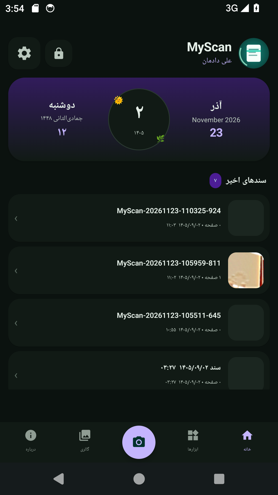
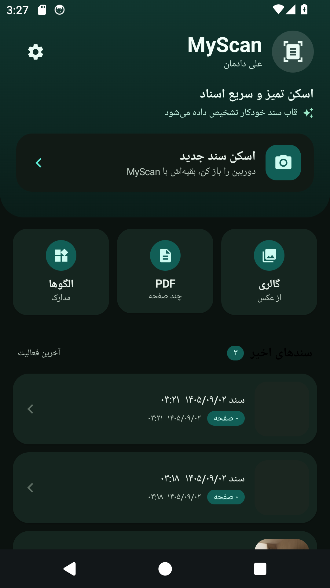
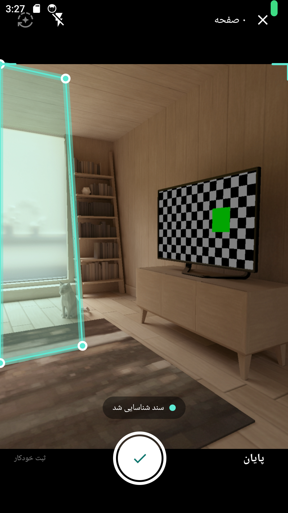
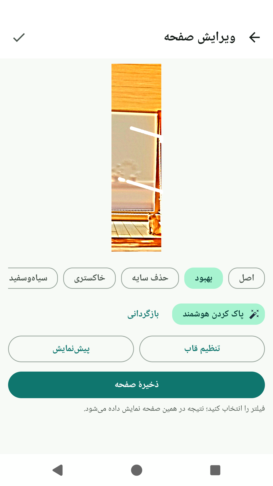
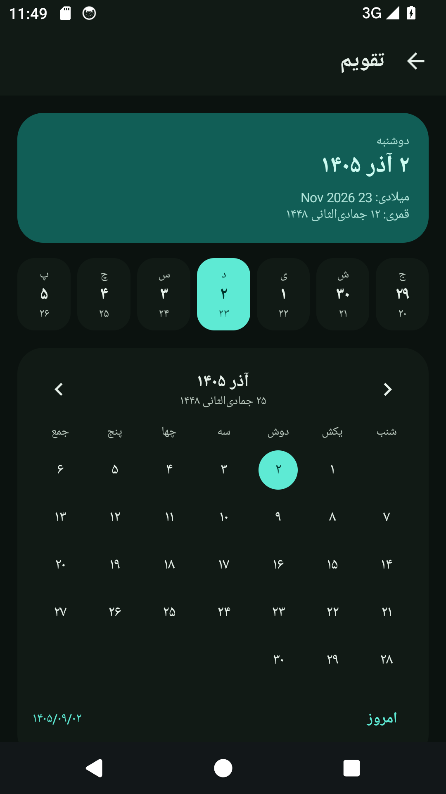
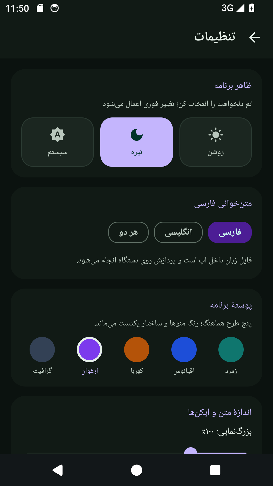
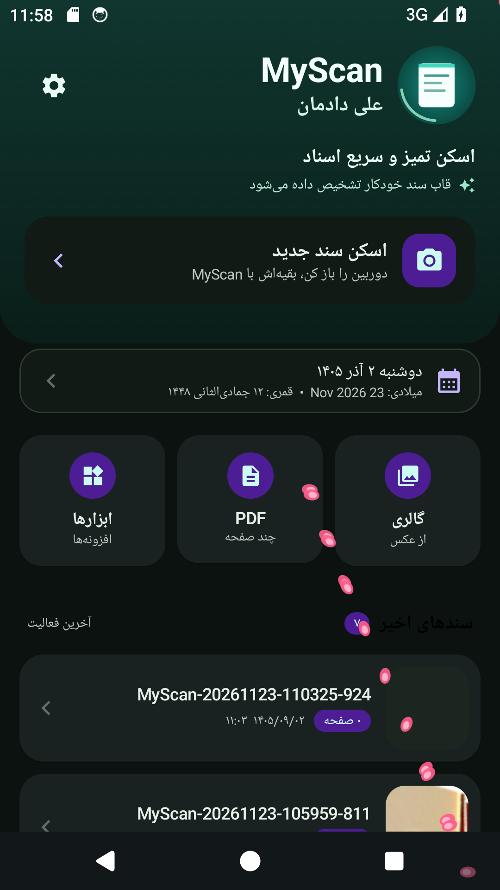
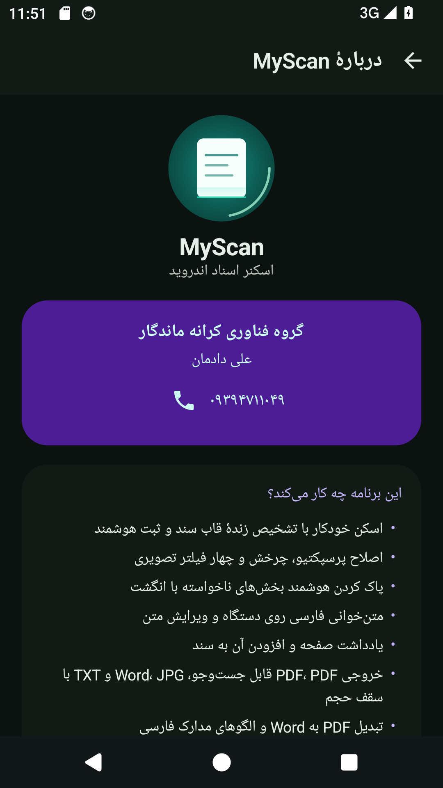
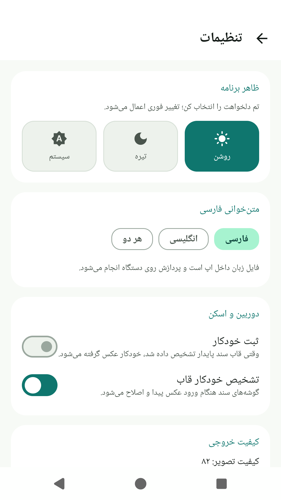
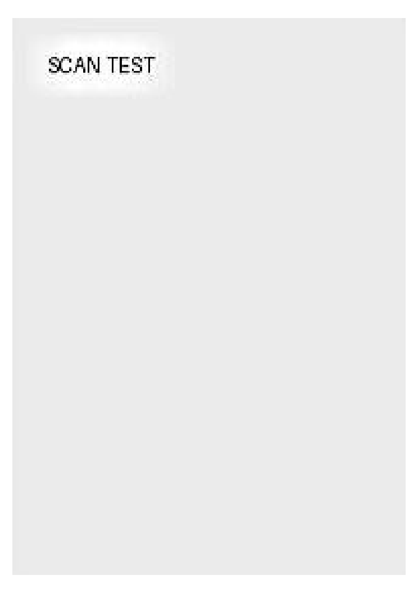

# MyScan — اسکنر اسناد اندروید

**علی دادمان**

[](https://github.com/adad-bot/MyScan/actions/workflows/build.yml)
[](LICENSE)

**APK:** از بخش [Actions](https://github.com/adad-bot/MyScan/actions) → آخرین بیلد موفق → Artifacts →
`app-debug-apk` را دانلود کنید، یا با `./gradlew :app:assembleDebug` خودتان بسازید.

اپلیکیشن اسکن اسناد با پردازش کاملاً محلی: دوربین قاب سند را زنده تشخیص می‌دهد، خودکار عکس می‌گیرد،
پرسپکتیو را اصلاح می‌کند، فیلتر می‌زند، متن فارسی را روی دستگاه می‌خواند و خروجی PDF، Word، JPG و TXT
با سقف حجم می‌سازد.

## تصاویر

| روشن | تیره |
|---|---|
|  |  |

| تشخیص زندهٔ قاب و ثبت خودکار | پاک کردن هوشمند |
|---|---|
|  |  |

| تقویم شمسی/میلادی/قمری | پوسته‌های رنگی |
|---|---|
|  |  |

| بارش گل رز کنار لوگو | دربارهٔ برنامه |
|---|---|
|  |  |

| تنظیمات (تم و بازخورد لمسی) | PDF ساخته‌شده در اپ |
|---|---|
|  |  |

## امکانات

- **ظاهر**: تم روشن، تیره و سیستم در تنظیمات با اعمال فوری؛ رنگ‌بندی سبز-تیل، گوشه‌های نرم و
  رابط راست‌به‌چپ. لوگوی زندهٔ MyScan با حلقهٔ چرخان و خط اسکن متحرک؛ با لمس لوگو، گل‌های رز ریز
  دو ثانیه از کنار لوگو به پایین می‌ریزند و با دو کلیک، صفحهٔ «درباره» باز می‌شود.
- **نام‌گذاری یکتا**: هر سند و فایل خروجی با MyScan-تاریخ-ساعت-شماره نام‌گذاری می‌شود
  (مثلاً MyScan-20261123-105959-811) تا هیچ دو فایلی هم‌نام نشوند.
- **تقویم سه‌گانه**: نوار تاریخ در صفحهٔ اصلی، تاریخ شمسی، میلادی و قمری را نشان می‌دهد؛ با لمس آن
  صفحهٔ تقویم با سه روز قبل و بعد و تقویم کامل ماه باز می‌شود (الگوریتم شمسی پورت‌شده از کتابخانهٔ MyC).
- **پوسته‌ها و اندازه**: پنج پوستهٔ رنگی (زمرد، اقیانوس، کهربا، ارغوان، گرافیت) و بزرگ‌نمایی متن و
  آیکن‌ها بین ۹۰ تا ۱۳۰ درصد در تنظیمات.
- **یادداشت**: افزودن صفحهٔ یادداشت به سند، ویرایش و حذف آن؛ یادداشت به‌صورت صفحهٔ A4 در خروجی‌ها می‌آید.
- **تبدیل PDF به Word**: در صفحهٔ افزونه‌ها؛ هر صفحه PDF رندر، متن‌خوانی و به DOCX تبدیل می‌شود.
- **تعامل زنده**: هر دکمه و کارت با لمس جمع می‌شود، موج لمسی می‌گیرد و لرزش بسیار کوتاه می‌دهد؛
  این لرزش از تنظیمات قابل خاموش‌کردن است. جابه‌جایی صفحه‌ها با انیمیشن.
- **اسکن خودکار**: تحلیل زندهٔ فریم دوربین هر ۰٫۳ ثانیه قاب سند را پیدا می‌کند، روی پیش‌نمایش می‌کشد
  و وقتی قاب پایدار شد خودکار عکس می‌گیرد. تیک «ثبت خودکار» بالای شاتر در همان صفحهٔ دوربین است و
  هر زمان قابل خاموش‌کردن است؛ پس از ثبت، تصویر خودکار برش می‌خورد و فیلتر «بهبود» می‌گیرد.
- **پاک کردن هوشمند**: در ویرایش صفحه، با انگشت هر نقطه را لمس کنید تا پاک شود؛ قبل از ذخیره
  قابل بازگردانی است.
- **اصلاح قاب**: تشخیص خودکار کاغذ، اصلاح پرسپکتیو با نگاشت هشت‌پارامتری، و ویرایش دستی چهار گوشه.
- **فیلترها**: بهبود (حذف سایه + کشش کنتراست + شارپ)، حذف سایه، خاکستری و سیاه‌وسفید با آستانهٔ محلی.
- **مدیریت سند**: انتخاب گروهی، چرخش، فیلتر گروهی، حذف، تغییر نام، آرشیو محلی با پیش‌نمایش صفحه.
- **الگوهای مدارک**: الگوی عمومی، مدارک ثبت‌نام و پروندهٔ حقوقی با کنترل کامل بودن مدارک.
- **OCR فارسی**: Tesseract4Android با مدل `fas` داخل APK، اجرای محلی، یکسان‌سازی «ی/ک» و ارقام،
  ویرایش متن در کنار تصویر.
- **خروجی**: PDF تصویری با سقف حجم، PDF قابل جست‌وجو، DOCX راست‌به‌چپ، JPG و TXT؛ ارسال با منوی
  اندروید و ذخیره با انتخاب‌گر فایل.

## گزارش محصول

- [گزارش کامل (DOCX)](docs/Android-Scanner-Report.docx)
- [گزارش کامل (PDF)](docs/Android-Scanner-Report.pdf)

## ساخت و نصب

پیش‌نیاز: JDK 17 و Android SDK با `platform 34` و `build-tools 34.0.0`.

```bash
./gradlew :app:assembleDebug
adb install -r app/build/outputs/apk/debug/app-debug.apk
```

در ویندوز:

```bat
gradlew.bat :app:assembleDebug
```

یا پوشه را در Android Studio باز کنید و Run بزنید.

> وابستگی OCR از JitPack تأمین می‌شود:
> `cz.adaptech.tesseract4android:tesseract4android:4.9.0`

## ساختار پروژه

```
app/src/main/java/ir/scanfa/app/
├── data/      مدل سند، ذخیره‌سازی JSON، الگوها، تنظیمات
├── image/     تشخیص قاب، وارپ، فیلترها، ورود PDF، ابزار تصویر
├── camera/    تحلیل زندهٔ فریم دوربین برای تشخیص قاب و ثبت خودکار
├── ocr/       موتور Tesseract و یکسان‌سازی متن فارسی
├── export/    PDF تصویری، PDF جست‌وجوپذیر، DOCX، JPG/TXT، اشتراک‌گذاری
├── vm/        ViewModel و هماهنگی پردازش
├── ui/        صفحه‌های Compose، تم، انیمیشن‌ها و بازخورد لمسی
└── util/      تاریخ شمسی
```

## آزمون

```bash
./gradlew :app:testDebugUnitTest
```

آزمون‌ها ساخت DOCX (ساختار بسته، متن فارسی، تصویر) و PDF (هدر، جدول xref، جاسازی JPEG) را بررسی
می‌کنند. اجرا و جریان کامل (نصب، ورود عکس، فیلتر، ذخیره، صدور PDF) روی شبیه‌ساز Pixel API 34 آزموده شده
است؛ سنجش دقت OCR فارسی با نمونهٔ چاپی و آزمایش دوربین روی گوشی واقعی باقی مانده است.

هر push به شاخهٔ `main` به‌صورت خودکار APK را با GitHub Actions می‌سازد
(workflow: [Build APK](.github/workflows/build.yml)).

## محدودیت‌ها

- OCR چیدمان چندستونه، جدول و فرمول را بازسازی نمی‌کند؛ کیفیت به نور و زاویه وابسته است.
- لایهٔ متن PDF قابل جست‌وجو مکان تقریبی سطرها را دارد و برای جست‌وجو ساخته شده، نه انتخاب دقیق کلمه.
- پوشاندن/حذف داده‌های حساس، ویرایش PDF و جست‌وجوی متن در آرشیو در نقشهٔ راه است.

## مجوز

[MIT](LICENSE)
